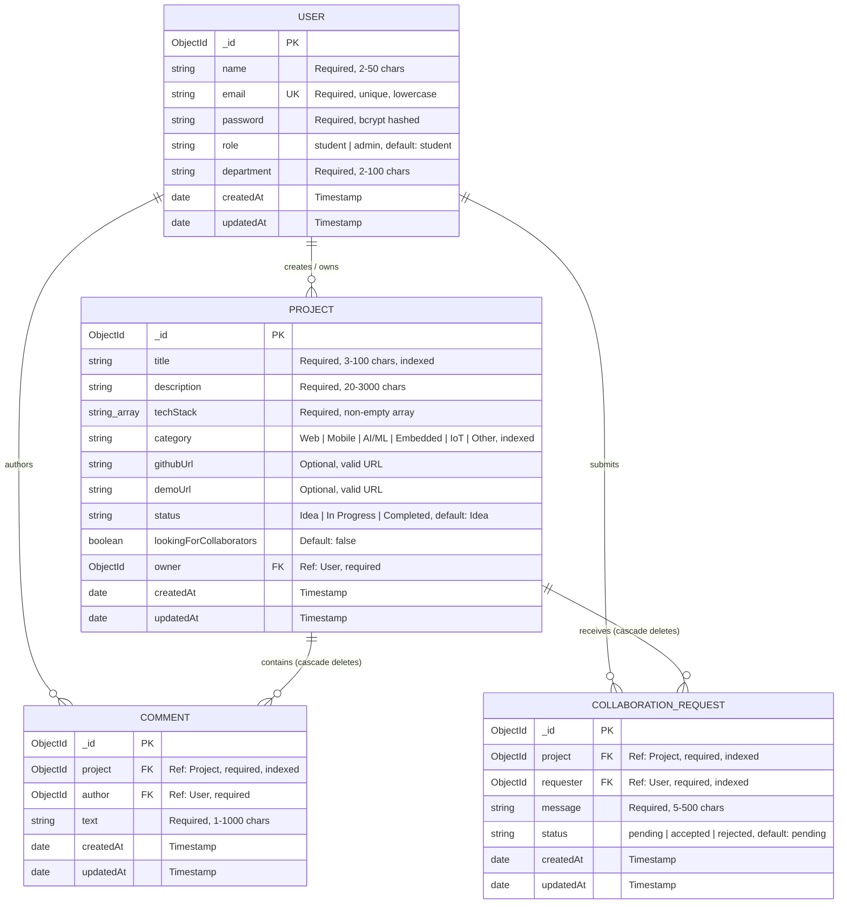

# ⚙️ Engineering Showcase — MERN Stack Application

A full-stack **MERN (MongoDB, Express, React, Node.js)** web platform built for engineering students and faculty to publish, explore, review, and collaborate on student capstones, research papers, hardware prototypes, and software innovations.

---

## 📑 Table of Contents
1. [Overview & Project Description](#-overview--project-description)
2. [Key Features](#-key-features)
3. [Tech Stack](#-tech-stack)
4. [Database Architecture & ERD](#-database-architecture--erd)
5. [Folder Structure](#-folder-structure)
6. [Prerequisites](#-prerequisites)
7. [Step-by-Step Setup Guide](#-step-by-step-setup-guide)
8. [Demo Evaluation Credentials](#-demo-evaluation-credentials)
9. [REST API Endpoint Reference](#-rest-api-endpoint-reference)
10. [Visual Showcase & Screenshots](#-visual-showcase--screenshots)
11. [License](#-license)

---

## 🌟 Overview & Project Description

**Engineering Showcase** serves as a centralized university repository and peer-collaboration network for engineering innovations. Students can publish their engineering systems, describe technical architecture, tag technologies, and invite peers to join their teams. Visitors and fellow students can filter projects across engineering categories, search by keywords, leave feedback, and submit collaboration pitches.

### Core Objectives:
- Provide an engineering-focused archive for undergraduate and graduate capstones.
- Enable cross-discipline collaboration across software, electronics, and mechanical engineering.
- Implement security best practices: JWT authentication, bcrypt hashing, express-validator sanitization, cascade deletions, and role-based permissions (student vs. admin).

---

## 🚀 Key Features

### 1. 🔐 Authentication & Session Security
- **JWT & bcryptjs**: Secure registration and password hashing.
- **Role-Based Access Control**: `student` and `admin` roles.
- **Expired Token Auto-Logout**: Automatic detection of expired tokens via client-side JWT decoding and Axios 401 interceptors, clearing stale state and redirecting to `/login?expired=true` with feedback.
- **Protected Routes**: React Router guards ensuring private features (Dashboard, Create/Edit, Collaboration) remain accessible only to authenticated users.

### 2. 📁 Project Showcase & Discovery
- **Debounced Keyword Search**: Instant search across titles, descriptions, and technology stacks with a 350ms debounce.
- **Multi-Filter System**: Filter by category (`Web`, `Mobile`, `AI/ML`, `Embedded`, `IoT`, `Other`) and status (`Idea`, `In Progress`, `Completed`).
- **Sorting & Pagination**: Sort by newest, oldest, or title (A–Z) with customizable per-page limits (6, 9, 12) and pagination controls.
- **Status & Category Badges**: Color-coded chips for engineering disciplines and milestones.

### 3. 📝 Project Management (CRUD)
- **Dual-Mode Project Form**: Single reusable component (`ProjectForm.jsx`) for project submission and editing with pre-filled fields.
- **Comprehensive Validation**: Client-side feedback and server-side express-validator checks (3–100 char title, min 20 char description, valid URLs, required tech stack).
- **Ownership Protection**: Edit and delete operations are restricted strictly to project owners or system administrators.
- **Cascade Deletion**: Deleting a project automatically cleans up all associated comments and collaboration requests to eliminate orphaned documents.

### 4. 💬 Peer Reviews & Discussions
- **Comments Thread**: Real-time commenting on projects for technical feedback and questions.
- **Author Permissions**: Comment authors and administrators can delete individual comments.

### 5. 🤝 Team Collaboration Pitching
- **Modal Submission Flow**: Students can submit collaboration requests with custom pitches.
- **Duplicate & Self-Request Guard**: Prevents students from requesting their own projects or submitting duplicate pending requests.
- **Owner Decisioning**: Project owners can **Accept** (`✓`) or **Reject** (`✕`) incoming pitches with real-time status updates.

### 6. 📊 Interactive Dashboard
- **My Projects Table**: Manage submitted projects with direct links to View, Edit, and Delete.
- **Incoming Collaboration Requests**: Review incoming pitches with one-click Accept/Reject buttons.
- **My Sent Requests**: Track pitches submitted to join other teams with color-coded status badges (`Accepted 🎉`, `Declined ✕`, `Pending Review ⏳`).

### 7. 🛡️ Fault Tolerance & UX Resilience
- **Reusable `ConfirmModal`**: Permanent warning confirmation dialog before deleting projects or comments.
- **Global Error Boundary**: Catches unexpected React runtime errors and renders a friendly fallback view with "Try Again" and "Return to Home" options.
- **Custom 404 Page**: Engineering-themed 404 page for nonexistent routes.
- **Loading & Error Feedback**: Spinners, inline field errors, banner alerts, and toast notifications on every API interaction.
- **Full Mobile Responsiveness**: Verified layouts across **375px** (mobile phones), **768px** (tablets), and **1280px** (desktops).

---

## 🛠️ Tech Stack

### Frontend (`/client`)
| Technology | Description |
|---|---|
| **React 18** | UI library with functional components and hooks |
| **Vite** | Fast frontend build tool and dev server |
| **React Router v7** | Client-side routing, protected routes, and layouts |
| **Axios** | HTTP client with request and response interceptors |
| **CSS3** | Modern vanilla CSS with variables, flexbox, CSS grid, and media queries |

### Backend (`/server`)
| Technology | Description |
|---|---|
| **Node.js** | Asynchronous JavaScript runtime environment |
| **Express.js** | Web framework for REST API routing and middleware |
| **MongoDB** | NoSQL document database |
| **Mongoose** | Object Data Modeling (ODM) with schemas and indexes |
| **jsonwebtoken** | Stateless JWT creation and verification |
| **bcryptjs** | One-way salt hashing for user passwords |
| **express-validator** | Request sanitization and server-side validation |
| **cors & dotenv** | Cross-origin resource sharing and environment management |

---

## 🗄️ Database Architecture & ERD

The database contains four interconnected collections: **User**, **Project**, **Comment**, and **CollaborationRequest**.



---

## 📁 Folder Structure

```
engineering-showcase/
├── README.md                           # Project documentation & setup guide
├── .gitignore                          # Git ignore for root, dependencies, & env
├── package.json                        # Root workspace configuration
│
├── server/                             # Node.js + Express REST API Backend
│   ├── .env.example                    # Sample backend environment variables
│   ├── package.json                    # Backend dependencies & scripts
│   ├── server.js                       # Express app entry point & route mounter
│   ├── seed.js                         # Database seed script (2 users, 8 projects)
│   ├── config/
│   │   └── db.js                       # Mongoose MongoDB connection
│   ├── controllers/
│   │   ├── authController.js           # Register, login, and getMe handlers
│   │   ├── projectController.js        # Full project CRUD, search, and pagination
│   │   ├── commentController.js        # Add, list, and delete comment handlers
│   │   └── collaborationController.js  # Submit, view, and accept/reject pitches
│   ├── middleware/
│   │   ├── authMiddleware.js           # JWT token verification (protect)
│   │   ├── errorHandler.js             # Centralized error handler & status codes
│   │   └── validate.js                 # Unified express-validator handler
│   ├── models/
│   │   ├── User.js                     # User schema (student/admin)
│   │   ├── Project.js                  # Project schema with text indexes
│   │   ├── Comment.js                  # Comment schema
│   │   └── CollaborationRequest.js     # Collaboration request schema
│   └── routes/
│       ├── authRoutes.js               # /api/auth routes
│       ├── projectRoutes.js            # /api/projects routes
│       ├── commentRoutes.js            # /api/comments routes
│       └── collaborationRoutes.js      # /api/collaborations routes
│
└── client/                             # React + Vite Frontend Application
    ├── .env.example                    # Sample frontend environment variables
    ├── index.html                      # HTML entry with viewport meta tag
    ├── package.json                    # Frontend dependencies & scripts
    ├── vite.config.js                  # Vite bundler configuration
    └── src/
        ├── App.jsx                     # Route definitions & ErrorBoundary wrapper
        ├── main.jsx                    # React root mount with ErrorBoundary
        ├── index.css                   # Global styles, layout, & responsive queries
        ├── components/
        │   ├── Navbar.jsx              # Responsive navigation with hamburger menu
        │   ├── Footer.jsx              # Footer with copyright & metadata
        │   ├── ProjectCard.jsx         # Card component for project grid
        │   ├── ConfirmModal.jsx        # Reusable modal for destructive deletions
        │   ├── ErrorBoundary.jsx       # Fallback UI for React runtime errors
        │   └── ProtectedRoute.jsx      # Auth gate for restricted views
        ├── context/
        │   ├── AuthContext.jsx         # Auth state, JWT decoding, & auto-logout
        │   └── ProjectContext.jsx      # Global projects state & CRUD actions
        ├── pages/
        │   ├── HomePage.jsx            # Landing page with hero & capabilities
        │   ├── LoginPage.jsx           # User login with demo account buttons
        │   ├── RegisterPage.jsx        # User registration with department select
        │   ├── ProjectsPage.jsx        # Showcase grid with search, filter, & sort
        │   ├── ProjectDetailPage.jsx   # Project view, comments, & collab modal
        │   ├── ProjectForm.jsx         # Reusable project create & edit form
        │   ├── DashboardPage.jsx       # Student dashboard with tabs & action tables
        │   └── NotFoundPage.jsx        # Custom 404 page with navigation actions
        ├── services/
        │   ├── api.js                  # Axios instance with 401 interceptor
        │   ├── authService.js          # Auth API calls
        │   ├── projectService.js       # Projects API calls
        │   ├── commentService.js       # Comments API calls
        │   └── collaborationService.js # Collaboration API calls
        └── utils/
            ├── constants.js            # Shared categories, statuses, departments
            └── formatters.js           # Badge styles, date, and text formatters
```

---

## 📋 Prerequisites

Before installing the application, ensure your environment has:
- **Node.js**: v18.0.0 or later ([Download Node.js](https://nodejs.org/))
- **npm**: v9.0.0 or later (installed with Node.js)
- **MongoDB**: MongoDB Community Server running locally on port `27017` or a [MongoDB Atlas](https://www.mongodb.com/cloud/atlas) connection URI.
- **Git**: Installed on your system.

---

## ⚙️ Step-by-Step Setup Guide

### Step 1: Clone Repository
```bash
git clone https://github.com/your-username/engineering-showcase.git
cd engineering-showcase
```

---

### Step 2: Configure Backend (`/server`)

1. Navigate to the server folder:
   ```bash
   cd server
   ```

2. Install backend dependencies:
   ```bash
   npm install
   ```

3. Create environment file:
   ```bash
   cp .env.example .env
   ```

4. Verify or adjust `server/.env`:
   ```env
   PORT=5001
   NODE_ENV=development
   MONGO_URI=mongodb://127.0.0.1:27017/engineering_showcase
   JWT_SECRET=super_secret_jwt_key_engineering_showcase_2026
   CLIENT_URL=http://localhost:5173
   ```

5. Seed the database with sample users and projects:
   ```bash
   npm run seed
   ```
   *Expected output:*
   ```
   Connected to MongoDB: mongodb://127.0.0.1:27017/engineering_showcase
   Cleared existing data...
   Inserted 2 users:
     - Alex Rivera (student)
     - Dr. Sarah Chen (admin)
   Inserted 8 sample projects across all categories
   Database seeding completed successfully!
   ```

6. Start the backend development server:
   ```bash
   npm run dev
   ```
   *The server starts on:* **`http://localhost:5001`**

---

### Step 3: Configure Frontend (`/client`)

1. Open a new terminal window and navigate to the client folder:
   ```bash
   cd engineering-showcase/client
   ```

2. Install frontend dependencies:
   ```bash
   npm install
   ```

3. Create client environment file:
   ```bash
   cp .env.example .env
   ```

4. Verify `client/.env`:
   ```env
   VITE_API_URL=http://localhost:5001/api
   ```

5. Start the Vite development server:
   ```bash
   npm run dev
   ```
   *The client starts on:* **`http://localhost:5173`**

6. Open your web browser and visit: **`http://localhost:5173`**

---

## 👤 Demo Evaluation Credentials

The database seed script provisions two test accounts with full access:

| Role | Email | Password | Department | Capabilities |
|---|---|---|---|---|
| **Student** | `alex.rivera@eng.university.edu` | `Password123!` | Computer Engineering | Create projects, submit pitches, edit owned projects, comment |
| **Administrator** | `sarah.chen@eng.university.edu` | `Password123!` | Electrical & Electronic Engineering | Modify/delete any project or comment, system oversight |

> **Tip**: The login page contains quick-fill buttons to automatically test either user with a single click.

---

## 📡 REST API Endpoint Reference

Base URL: `http://localhost:5001/api`

### 1. Authentication Endpoints (`/api/auth`)

| Method | Endpoint | Access | Status Codes | Description |
|:---:|---|:---:|:---:|---|
| `POST` | `/api/auth/register` | Public | `201`, `400`, `409` | Registers a new student or admin; returns JWT token and user profile |
| `POST` | `/api/auth/login` | Public | `200`, `400`, `401` | Validates credentials; returns JWT token and user profile |
| `GET` | `/api/auth/me` | Protected | `200`, `401` | Retrieves the profile of the currently logged-in user |

### 2. Project Endpoints (`/api/projects`)

| Method | Endpoint | Access | Status Codes | Description |
|:---:|---|:---:|:---:|---|
| `GET` | `/` | Public | `200` | Health check & list of available API endpoints |
| `GET` | `/api/projects` | Public | `200` | List projects with query params: `search`, `category`, `status`, `owner`, `sort`, `page`, `limit` |
| `GET` | `/api/projects/:id` | Public | `200`, `400`, `404` | Get detailed information for a single project (with populated owner) |
| `POST` | `/api/projects` | Protected | `201`, `400`, `401` | Create a new project (logged-in user assigned as owner) |
| `PUT` | `/api/projects/:id` | Protected | `200`, `400`, `401`, `403`, `404` | Update an existing project (owner or admin only) |
| `DELETE` | `/api/projects/:id` | Protected | `200`, `400`, `401`, `403`, `404` | Delete a project and cascade-delete its comments & collaboration requests |

### 3. Comment Endpoints (`/api/projects/:id/comments`, `/api/comments/:id`)

| Method | Endpoint | Access | Status Codes | Description |
|:---:|---|:---:|:---:|---|
| `GET` | `/api/projects/:id/comments` | Public | `200`, `400`, `404` | Fetch all comments for a project sorted newest first |
| `POST` | `/api/projects/:id/comments` | Protected | `201`, `400`, `401`, `404` | Add a comment to a project |
| `DELETE` | `/api/comments/:id` | Protected | `200`, `400`, `401`, `403`, `404` | Delete a comment (comment author or admin only) |

### 4. Collaboration Endpoints (`/api/collaborations`, `/api/projects/:id/collaborate`)

| Method | Endpoint | Access | Status Codes | Description |
|:---:|---|:---:|:---:|---|
| `POST` | `/api/projects/:id/collaborate` | Protected | `201`, `400`, `401`, `404` | Send a collaboration request (prevents self-request & duplicates) |
| `GET` | `/api/collaborations/incoming` | Protected | `200`, `401` | Retrieve requests targeted to projects owned by the logged-in user |
| `GET` | `/api/collaborations/mine` | Protected | `200`, `401` | Retrieve requests sent by the logged-in user to other projects |
| `PATCH` | `/api/collaborations/:id` | Protected | `200`, `400`, `401`, `403`, `404` | Accept or reject a collaboration request (`status: 'accepted' \| 'rejected'`) |

---

## 📸 Visual Showcase & Screenshots

> Place application screenshots in `docs/screenshots/` to display live previews in this section.

### 1. Landing & Home Page
Explore platform capabilities, statistics, and quick navigation.

```
+-----------------------------------------------------------------------+
|  [⚙️ EngineeringShowcase]       Home   Showcase   Dashboard   [Log In] |
|                                                                       |
|                     Engineering Showcase Platform                     |
|           Discover Inspiring Student Engineering Projects             |
|                                                                       |
|             [ Explore Showcase ]      [ Submit Your Project ]         |
+-----------------------------------------------------------------------+
```
*(Screenshot placeholder: `docs/screenshots/01-home-page.png`)*

---

### 2. Projects Showcase Directory
Responsive grid with debounced search, category filters, and pagination.

```
+-----------------------------------------------------------------------+
|  🔍 [ Search by title, tech stack... ]   Category: [All]   Sort: [New] |
|  Showing 6 of 8 total projects                                        |
|  +--------------------+  +--------------------+  +--------------------+ |
|  | AI/ML    Completed |  | IoT    In Progress |  | Web          Idea  | |
|  | Autonomous Drone   |  | Smart Agriculture  |  | Peer Code Review   | |
|  | Python, PyTorch    |  | C++, FreeRTOS, ESP |  | React, Node, Mongo | |
|  | [View] [Edit] [🗑]  |  | [View] [Edit] [🗑]  |  | [View] [Edit] [🗑]  | |
|  +--------------------+  +--------------------+  +--------------------+ |
|                         [← Prev]  [1]  [2]  [Next →]                  |
+-----------------------------------------------------------------------+
```
*(Screenshot placeholder: `docs/screenshots/02-projects-showcase.png`)*

---

### 3. Project Details & Collaboration Modal
Comprehensive project specification, GitHub/live demo links, comments list, and collaboration pitch modal.

```
+-----------------------------------------------------------------------+
|  ← Back to Showcase                                                   |
|  Autonomous Drone Navigation with Edge AI                             |
|  Status: [Completed] • Owner: Alex Rivera • Category: [AI/ML]         |
|  -------------------------------------------------------------------  |
|  Project Description, Architecture Specs, and Live Links              |
|  [📦 GitHub Repository]                 [🌐 Open Live Demo]           |
|                                                                       |
|  🤝 Seeking Collaborators?  [ Request to Collaborate ]               |
|                                                                       |
|  💬 Peer Discussion & Reviews (4)                                      |
|  [ Share constructive feedback or engineering questions... ]          |
+-----------------------------------------------------------------------+
```
*(Screenshot placeholder: `docs/screenshots/03-project-details.png`)*

---

### 4. Interactive Student Dashboard
Tabbed interface: My Projects table, Incoming Collaboration Requests with Accept/Reject, and Sent Pitches.

```
+-----------------------------------------------------------------------+
|  Student Portal: Alex Rivera (Computer Engineering)                   |
|  [ 📁 My Projects (3) ]   [ 📬 Incoming (2) ]   [ 📤 My Sent (1) ]    |
|  -------------------------------------------------------------------  |
|  Project Title        Category   Status       Collab    Actions       |
|  Autonomous Drone     AI/ML      Completed    🤝 Yes    [View] [Edit] |
|  Smart Grid Monitor   IoT        In Progress  No        [View] [Edit] |
+-----------------------------------------------------------------------+
```
*(Screenshot placeholder: `docs/screenshots/04-dashboard.png`)*

---

### 5. Reusable Confirmation Modal (`ConfirmModal`)
Safe deletion modal requiring explicit user confirmation before permanent removal.

```
+-----------------------------------------------------------------------+
|                       ⚠️ Delete Showcase Project                       |
|                       Permanent Deletion Warning                      |
|                                                                       |
|  Target Item: "Autonomous Drone Navigation with Edge AI"              |
|  Are you sure you want to permanently delete this project? This will  |
|  also remove all associated peer comments and collaboration requests. |
|                                                                       |
|                  [ Cancel ]       [ 🗑️ Delete Project ]                |
+-----------------------------------------------------------------------+
```
*(Screenshot placeholder: `docs/screenshots/05-confirm-modal.png`)*

---

### 6. Mobile Responsive Views (Tested at 375px & 768px)
Fluid hamburger navigation drawer, stacked form columns, horizontal table scrolling, and touch-friendly actions.

```
+-----------------------+
| [=] EngineeringShowcase
| --------------------- |
| 🔍 Search projects... |
| Category: [All v]     |
| --------------------- |
| +-------------------+ |
| | Autonomous Drone  | |
| | [AI/ML]           | |
| | [View Details]    | |
| +-------------------+ |
+-----------------------+
```
*(Screenshot placeholder: `docs/screenshots/06-mobile-view.png`)*

---

## 📄 License

This project is licensed under the [ISC License](LICENSE). Built for academic and showcase purposes at the Faculty of Engineering.
